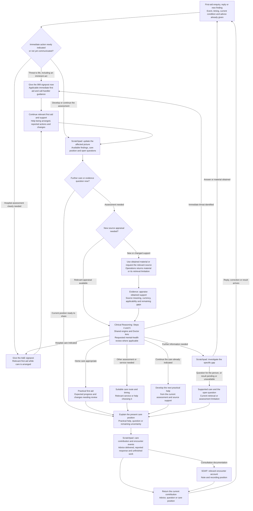

# First Aid Tool

[Grid Card](<GRID_CARD.md>)

## Purpose

First Aid develops practical help for injury, sudden illness and continuing first-aid needs. The account, relevant history and appraised references contribute to immediate care, assessment and the next care route. A threatened imminent life-threatening act can need immediate help before injury occurs. These service references concern the UK.

## Working procedure

1. **Identify the immediate need.** Use the reported event, present condition and help already given to select the immediate-care or developing-assessment route.
2. **Provide and continue the indicated help first.** Use the applicable immediate procedure already at hand, with the person's age, presentation and available means. The first contribution gives the action needed now; additional history and source questions develop alongside continuing help. Continue practical help, call-handler guidance and reassessment while further source questions are addressed.
3. **Develop the relevant picture.** Scratchpad brings together the account, available history and focused questions that affect the next action. Operations obtains additional material where needed.
4. **Appraise and assess.** Evidence examines the relevant source procedure and its applicability; Clinical Reasoning Steps 4 and 5 supply the assessment and professional contribution requested by First Aid.
5. **Explain the next care step and review.** Translate the supported assessment into practical help, care route and changes needing reassessment. Record advice, reported actions and unfinished matters for the ongoing enquiry and its SOAP.

## Process map

The immediate-care sequence begins with the indicated action and care signpost, continues practical support and call-handler guidance, and adapts to the person’s response and changing findings. Further assessment and the clinical account develop as care proceeds.

## Entry and developing the picture

An accident or injury within the last 24 hours, sudden illness or continuing first-aid need brings the enquiry here. The account describes what happened, its timing, current condition and what has been tried. The scratchpad develops the picture. Focused questions concern details that could change care, such as site, mechanism, change over time, age or help being arranged. An older injury can still need first aid.

Relevant conditions, medicines, allergies and usual function can affect interpretation and the suitability of a measure. Operations obtains further records or references for specific questions; Evidence appraises their meaning and limitations. First Aid can interrupt an existing enquiry while its other unfinished matters retain their place.

## Reference material

### Medical-library starting points

These publication references are starting points for the relevant care question. Printed folios and PDF page numbers are different locators. The actual passage and source metadata establish the material obtained. Deployment information holds interface-specific identifiers and citation aliases.

| Publication | Topic and PDF location |
| --- | --- |
| Oxford Handbook of Clinical Medicine, 11th edition (2024) | Acute coronary syndromes, PDF 124; acute stroke, PDF 476. |
| Oxford Textbook of Medicine, 6th edition, volume 3 (2020) | Chest pain/acute coronary syndromes, PDF 107; acute coronary syndrome presentation, PDF 457. |
| Oxford Textbook of Medicine, 6th edition, volume 4 (2020) | Cerebrovascular disease and speech/language presentation, located by source-scoped retrieval. |
| Oxford Handbook of Emergency Medicine, 5th edition (2020) | Choking, PDF 66; head-injury triage, PDF 383; minor head injury, PDF 393; smaller burns, PDF 423; open fractures, PDF 447; sprains/strains, PDF 451; nosebleeds, PDF 587. |
| Oxford Handbook of General Practice, 5th edition (2020) | Adult basic life support, PDF 1057. |

Reference books contain clinical-service treatment as well as lay first aid. Appraisal identifies which part applies to the person, helper, age, setting and available means. Their presence in a library does not by itself establish suitability or current procedure.

### Online procedural references

These are public-web sources, distinct from local library holdings. They can supply contemporary procedural guidance alongside the reference books. A verified local copy, where supplied, is a separate dated representation with its own provenance. Availability, readable content, currency and applicability are assessed for the source actually obtained.

| Question | Source to retrieve |
| --- | --- |
| Choking, severe bleeding and other time-critical first aid | [Resuscitation Council UK: First Aid Guidelines, 2025](https://www.resus.org.uk/professional-library/2025-resuscitation-guidelines/first-aid-guidelines). |
| An unresponsive adult, CPR or an AED | [Resuscitation Council UK: Adult Basic Life Support, 2025](https://www.resus.org.uk/professional-library/2025-resuscitation-guidelines/adult-basic-life-support-guidelines), including the community procedure. |
| First aid and basic life support for an infant or child | [Resuscitation Council UK: Paediatric Life Support (basic and advanced), 2025](https://www.resus.org.uk/professional-library/2025-resuscitation-guidelines/paediatric-basic-life-support-guidelines), using the age-appropriate first-aid and basic life-support sections. |
| Suicidal thoughts and a threatened or imminent act | [RCUK First Aid Guidelines, Suicidal thoughts](https://www.resus.org.uk/professional-library/2025-resuscitation-guidelines/first-aid-guidelines) and [NHS: help for suicidal thoughts](https://www.nhs.uk/mental-health/feelings-symptoms-behaviours/behaviours/help-for-suicidal-thoughts/). |
| Suspected poisoning or harmful ingestion | [NHS: poisoning](https://www.nhs.uk/conditions/poisoning/), including help while awaiting medical care. |
| Burns or scalds | [NHS: burns and scalds](https://www.nhs.uk/conditions/burns-and-scalds/). |
| Nosebleed | [NHS: nosebleed](https://www.nhs.uk/conditions/nosebleed/). |
| Sprain or strain | [NHS: sprains and strains](https://www.nhs.uk/conditions/sprains-and-strains/). |
| Small wound | [NHS: cuts and grazes](https://www.nhs.uk/conditions/cuts-and-grazes/). |

### Applying the evidence

Evidence relates the obtained passage to the particular care question: its meaning, age group, urgency, setting and procedural conditions. A heading, incomplete diagram or damaged number can leave a specific gap. The source's date and restrictions inform appraisal; practical guidance follows what the inspected material supports rather than the title of the source alone.

A clinical question goes to Clinical Reasoning Steps 4 and 5 with the current picture and available appraisal. The Doctor perspective supplies medical assessment; a pharmacy or other professional question can bring its relevant perspective in this set. A requested mental-health review contributes in its established place. First Aid uses the returned assessment for practical help and suitable onward care.

Practical advice turns the supported procedure into actions appropriate to the person or helper: what comes first, how it is done, relevant timing and precautions. A new finding or correction can change the next action; existing support contributes while a new source question returns to Evidence.

## Continuing while help is arranged

The person or helper may report a call made, an intention to call or help arriving. Those are different positions for the next response. Continuing help can involve practical assistance, a focused question, clarification or support while help is arranged. A gap in replies leaves the condition and progress unconfirmed.

### Immediate-care procedures

The procedures below address the specified presentations, with the named UK primary sources. The clinical action depends on the person’s age, presentation, setting and available help. Source/version and review information is maintained in the immediate-care reference manifest.

**ICP-01 · Unresponsive adult / suspected cardiac arrest.** Check that approaching is safe. Call 999 on speakerphone and assess breathing as the call connects. Gasping or other abnormal breathing is not normal breathing: start CPR. With the person on their back, place one hand’s heel over the lower half of the breastbone and the other on top, arms straight; compress 5–6 cm at 100–120/min with full release. A helper not trained in rescue breaths gives continuous compressions; a trained helper uses 30 compressions to two breaths. Use an available AED and follow its prompts, keeping everyone clear during analysis/shock. Continue until professional help takes over or directs stopping, normal breathing/clear signs of life return, or the helper cannot continue. [RCUK Adult Basic Life Support 2025](https://www.resus.org.uk/professional-library/2025-resuscitation-guidelines/adult-basic-life-support-guidelines); [RCUK First Aid 2025](https://www.resus.org.uk/professional-library/2025-resuscitation-guidelines/first-aid-guidelines). Infant and child resuscitation uses the age-specific paediatric guidance.

**ICP-02 · Adult choking.** If the person can cough effectively, encourage coughing and watch for deterioration. If the cough is ineffective/severe obstruction, arrange emergency help early; where another helper is present, have them call while physical first aid continues. Give up to five back blows; if ineffective, give up to five abdominal thrusts. Continue alternating five back blows and five abdominal thrusts until the obstruction clears or the person becomes unresponsive. Do not use blind finger sweeps and do not give water to try to force an obstruction down. If the person becomes unresponsive, lower/support them safely, ensure 999 has been called and start CPR. After successful treatment with abdominal thrusts or chest compressions, advise healthcare assessment because complications or injury can occur. [RCUK First Aid 2025](https://www.resus.org.uk/professional-library/2025-resuscitation-guidelines/first-aid-guidelines).

**ICP-03 · Life-threatening external bleeding.** Call 999 and control bleeding at once. Apply firm, continuous direct manual pressure over the bleeding site using a dressing or any clean available material; maintain pressure while help is arranged rather than repeatedly lifting it to inspect the wound. Once controlled, a pressure dressing can secure the dressing. Escalation to haemostatic dressings or a tourniquet depends on severe extremity bleeding, available equipment/training and call-handler guidance; do not improvise a narrow-cord tourniquet. Stay with the person, monitor responsiveness/breathing and report deterioration to 999. [RCUK First Aid 2025 - control of life-threatening bleeding](https://www.resus.org.uk/professional-library/2025-resuscitation-guidelines/first-aid-guidelines); [London Ambulance Service - bystander bleeding control](https://www.londonambulance.nhs.uk/our-services/emergency-care/emergency-care-advice/emergency-trauma-care/).

**ICP-04 · Thermal burn or scald.** Stop the burning process safely and cool the affected area under cool running water for **20 minutes** as soon as possible. Remove nearby clothing, jewellery or a nappy where it is not stuck; do not pull away material adherent to the skin. Keep the rest of the person warm, especially a child. After cooling, loosely cover with cling film or a clean non-fluffy covering where suitable. Do not use ice, butter, creams/oils or deliberately burst blisters. Severity, size, site, age and subsequent blistering/uncertainty determine whether 111, an injury service, A&E or 999 is appropriate; a large scald in a young child needs urgent hospital assessment while cooling continues. [NHS - burns and scalds](https://www.nhs.uk/conditions/burns-and-scalds/); [NHS - child accident first aid](https://www.nhs.uk/baby/first-aid-and-safety/first-aid/what-to-do-if-your-child-has-an-accident/).

**ICP-05 · Chemical in the eye.** Start irrigation immediately: use lots of clean water that is not hot, hold the eye open and rinse gently for **at least 20 minutes**. Keep rinsing while emergency assessment is arranged for a strong chemical or visual change. Another helper can obtain the product/container information in parallel; do not delay irrigation for a safety sheet. Do not rub the eye, do not try to neutralise the chemical with another chemical, and do not drive with impaired vision. Take the container/product information to care where safe. [NHS - eye injuries](https://www.nhs.uk/conditions/eye-injuries/).

In remote discussion, observation and physical help come from people at the scene. The account brings their reports into reassessment. The earlier enquiry and its unanswered questions remain available as the immediate need changes.

## Presentations leading directly to 999

### What a heart attack might look like

The person may describe pressure, heaviness, squeezing or pain in the centre of the chest, sometimes spreading to an arm, the neck, jaw or back. Breathlessness, sweating, nausea, vomiting or looking pale may accompany it. Some heart attacks present with little or no chest pain; breathlessness, collapse or upper-abdominal discomfort may be more prominent. These possible presentations are interpreted in the current clinical picture.

Library starting points: **Oxford Handbook of Clinical Medicine**, acute coronary syndromes; **Oxford Textbook of Medicine**, volume 3, chest pain and acute coronary syndrome entries listed in the reference table. The returned passage and its metadata supply the clinical support and page reference used in the enquiry.

**When a heart attack is suspected: call 999 now and ask for an ambulance.** [NHS: heart attack](https://www.nhs.uk/conditions/heart-attack/) and [RCUK: chest pain](https://www.resus.org.uk/professional-library/2025-resuscitation-guidelines/first-aid-guidelines).

### What a stroke might look like

A stroke may cause a sudden droop or weakness on one side of the face, weakness or numbness in an arm or down one side of the body, slurred speech, difficulty finding words or difficulty understanding speech. Sudden loss or disturbance of vision, or new difficulty with balance and coordination, can also form part of the presentation. The onset or last time the person was known to be well contributes to the account.

Library starting points: **Oxford Handbook of Clinical Medicine**, acute stroke assessment; **Oxford Textbook of Medicine**, volume 4, cerebrovascular disease. The clinical passage and its page reference are established through the retrieval and appraisal above.

**When a stroke is suspected: call 999 now and ask for an ambulance.** Stroke symptoms within the last 24 hours take this route even if they have stopped. [NHS: stroke symptoms](https://www.nhs.uk/conditions/stroke/symptoms/).

### A threatened or imminent life-threatening act

A concrete suicidal threat or plan can indicate **999 help before an injury has occurred**. First Aid explains that immediate need to the person or helper. The account can establish the urgency while a fuller assessment remains open. The [RCUK 2025 Suicidal thoughts section](https://www.resus.org.uk/professional-library/2025-resuscitation-guidelines/first-aid-guidelines) supports direct enquiry about suicidal thoughts where needed, non-judgmental listening and emergency help for concrete threats or plans.

Following the immediate signpost, the conversation acknowledges the person's distress and focuses on the next achievable step. Practical support can include asking a trusted person to come or make the call, and moving away from accessible means of harm or having someone remove them where this is safe. [NHS: help for suicidal thoughts](https://www.nhs.uk/mental-health/feelings-symptoms-behaviours/behaviours/help-for-suicidal-thoughts/); [Mind: coping with suicidal thoughts, Make yourself safe](https://www.mind.org.uk/information-support/suicidal-thoughts-and-suicide-prevention/coping-and-self-care/).

The next account distinguishes an intended act from harm already reported. Suspected harmful ingestion needs immediate medical help even when symptoms have not appeared; poisoning symptoms can be delayed. Information about the substance and available packaging can assist the responding clinicians. While awaiting help after a suspected ingestion, NHS guidance advises against inducing vomiting or giving food or drink; continuing observation of breathing and responsiveness informs the next action. [NHS: poisoning](https://www.nhs.uk/conditions/poisoning/).

When immediate emergency action is not indicated, the assessed need can lead to professional or crisis support. **Samaritans, 116 123**, offers listening support. Such support has a different role from an ambulance or emergency assessment already indicated; it can accompany that care rather than replace it. [NHS: help for suicidal thoughts](https://www.nhs.uk/mental-health/feelings-symptoms-behaviours/behaviours/help-for-suicidal-thoughts/).

## Further care and the advice given

The assessment connects the findings to a practical next step. These are care routes; the relevant presentation determines the service and urgency.

| Care route | What it means in the current enquiry |
| --- | --- |
| **Home first aid** | Basic care is appropriate for the assessed problem, with practical measures, expected progress and changes calling for further assessment. |
| **A&E** | Hospital assessment or treatment is indicated, with its reason, urgency and relevant first aid while care is arranged. Someone knocked out by a head injury who has now woken up needs A&E; continuing unconsciousness or difficulty staying awake takes the 999 route. [NHS: head injury with loss of consciousness](https://www.nhs.uk/conditions/subdural-haematoma/). |
| **999 now** | Current unresponsiveness, suspected heart attack or stroke, another suspected life-threatening emergency, or a threatened or imminent life-threatening act. The immediate signpost is followed by relevant practical help and continuing support. [RCUK: adult basic life support](https://www.resus.org.uk/professional-library/2025-resuscitation-guidelines/adult-basic-life-support-guidelines), [RCUK: First Aid](https://www.resus.org.uk/professional-library/2025-resuscitation-guidelines/first-aid-guidelines), [NHS: head injury](https://www.nhs.uk/conditions/head-injury-and-concussion/). |
| **Another clinical service or NHS 111** | Further help through a GP, urgent treatment centre, injury service or relevant mental-health service, with the appropriate timing. NHS 111 can help assess an urgent concern and identify a service where that is uncertain; arrangements depend on the UK nation. [NHS: when to use 111 and routes elsewhere in the UK](https://www.nhs.uk/nhs-services/urgent-and-emergency-care-services/when-to-use-111/). |

A **possible broken limb** needs prompt in-person assessment and may need an X-ray. NHS 111 can help locate an appropriate injury service where that service applies. Deformity, exposed bone, circulation or sensation changes, and substantial wounds can indicate the need for A&E or an ambulance, interpreted with the injury and overall condition. [NHS: broken arm or wrist](https://www.nhs.uk/conditions/broken-arm-or-wrist/), [broken leg](https://www.nhs.uk/conditions/broken-leg/).

Travel reflects the person's condition and the assessed route. Another person can drive to A&E when suitable; inability to get someone with a head injury there safely is a reason for 999 help. [NHS: head injury and getting to A&E](https://www.nhs.uk/conditions/subdural-haematoma/).

The chat response articulates the action needed now, relevant assessment, practical help and any focused question or review advice. The scratchpad receives advice actually delivered, the person's reported response, help arranged to the extent established, relevant requests and responses, and unfinished matters. Where assistance was withheld, the account records the affected request, response and alternative help given as encounter events.

The [SOAP Creation tool](<SOAP_TOOL.md>) draws the relevant account into the developing consultation record. A requested note or a closing account follows its documentation and recording arrangement, with Operations supplying any storage result. Recording is distinct from continuing first aid, arranging external help and closing the encounter. An unresolved care question or unknown outcome remains part of the position returned to the current consultation process.
