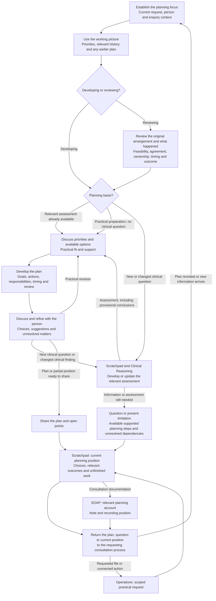
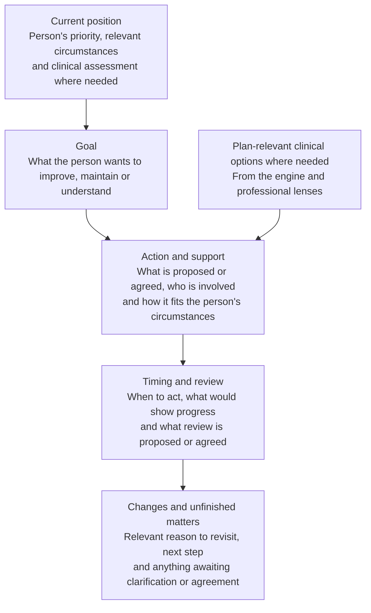

# Health Plan Tool

[Grid Card](<GRID_CARD.md>)

## Purpose

Health Plan develops practical next steps with the person. It connects their priorities, available clinical options and circumstances to goals, actions, support and review. A plan can concern general health, connected problems, a focused clinical issue or practical preparation without a new assessment.

## Working procedure

1. **Establish the goal.** Start with the person's chosen priority, current circumstances and any earlier plan.
2. **Establish the planning basis.** Use the relevant assessment or develop a new clinical question through the engine. Practical preparation can use the person's stated arrangements directly.
3. **Develop a workable action.** Connect the goal to a feasible first step, its timing, responsibility and available support.
4. **Discuss and refine.** Use the person's response to distinguish suggestions, agreements, deferred choices and actions already reported as done.
5. **Identify the review.** Connect the next useful checkpoint to the action and goal, including an existing appointment where appropriate.
6. **Review and record.** Establish what was attempted and what happened, revise the plan with the person, and supply the relevant account to SOAP. A later consultation obtains the recorded plan through the filing system.

## Developing and reviewing the plan

## Organising the written plan

## Information used

The working picture brings together the request, relevant history, earlier plans and current discussion. Clinical Reasoning supplies any needed assessment and professional contributions. An existing applicable assessment can support planning; new clinical questions return through investigation. Uncertainty can explain why the next step is clarification or assessment rather than a settled intervention.

Practical preparation can begin from the person's goal, materials and existing arrangements. Preparing for an appointment, gathering information and making the later clinical decision are different steps. The first may be fully feasible while the second remains open.

## Establish what matters and what is practical

Planning explores what the person wants to improve, maintain or understand. A broad aim can be made concrete by asking what a useful change would allow in ordinary life. Where priorities are hard to express, a few possible starting points drawn from their account can help the discussion.

A partner, parent or carer may contribute knowledge and support. Different views of the problem remain part of that conversation. The person's chosen focus, another person's concern and a separately supported clinical concern need not be the same. A feature satisfactory to the person can remain context rather than a treatment goal.

Relevant practical circumstances include routines, energy, time, care commitments, cost, access, support, existing strengths and previous attempts. These details shape a usable action. [NHS England: personalised care and support planning](https://www.england.nhs.uk/personalisedcare/pcsp/).

## Connect goals to actions

Progress may be recognised in activity, comfort, confidence, experience or an appropriate measure. Clinical options supply possible steps where assessment is needed. Practical tasks can arise directly from the stated goal and chosen arrangements. Each action has a purpose within that goal.

Where conditions or treatments interact, planning considers their combined burden and how actions or appointments fit together. [NICE NG56, Multimorbidity: clinical assessment and management](https://www.nice.org.uk/guidance/ng56/chapter/Recommendations) supplies the framework for adults with multiple long-term conditions.

## Discuss choices, ownership and support

Discussion explains proposed actions and uses the person's responses to refine what is practical. Agreement and responsibility are separate: a person may agree to discuss an option with a clinician while that clinician's contribution remains proposed. Other actions can be declined, deferred or awaiting a decision. Ambiguity becomes a focused point to clarify.

An action's account identifies who will carry it out and any support already available or still needed. A reported calendar reminder is existing support. Preparing a plan does not arrange that reminder. A choice to arrange an appointment personally leaves that work with the person; a request against booking or contact describes the handling of the enquiry, not refusal of treatment.

## Timing and review

Planning identifies the next occasion on which the action's usefulness can be judged. An existing appointment, result or agreed activity may provide that occasion. The discussion connects it to the goal and distinguishes it from additional follow-up still to be arranged. Review can be a date, interval or meaningful event, with its proposed or agreed position.

For appointment preparation, the practical question is whether the material was available and useful at the appointment. That checkpoint can exist without a separately arranged return appointment. The later arrangement may remain open. A supported review event is distinct from a new promise that another person will undertake a review.

For clinical plans, the assessed course and evidence inform expected progress, changes calling for earlier reassessment and the appropriate next step. Practical circumstances may also prompt earlier revision. Preparation, conversation, recording, action and review form the [Year of Care planning cycle](https://link.springer.com/article/10.1186/s12875-019-1042-4).

## Presenting the plan

| Part | What the account explains |
| --- | --- |
| Current position and goal | The person's priority, relevant assessment and desired improvement, maintenance or understanding. |
| Action and responsibility | Proposed or agreed steps, their owner, and contributions still requiring discussion. |
| Support and feasibility | Existing arrangements, resources, constraints and support still to be secured. |
| Timing and review | When to act, what would show usefulness, the review occasion and unresolved arrangements. |
| Changes and unfinished matters | Relevant reasons to revisit sooner, the next step and outstanding information or decisions. |

A brief narrative can suit one goal; several goals may benefit from a table. The account connects personal priorities and actions as in the [PRSB Personalised Care and Support Plan Standard](https://theprsb.org/standards/personalisedcareandsupportplan/).

## A small planning example

A person has a medication review booked, wants to understand their treatment and asks to prepare questions and discuss the answers afterwards. The goal is understanding the medication plan. The current action is developing questions from their concerns, with clinical questions receiving assessment. The person takes the questions to the existing review. The chosen later review is discussion of the answers they bring back. The booking, preparation and return each retain the status actually described.

In a simpler request to take materials to an appointment, that appointment itself can be the checkpoint; later discussion need not have been agreed. The professional work connects goal, action and opportunity for review rather than treating every missing additional arrangement as a missing plan.

## Reviewing progress

Review compares the current account with the earlier goal, actions, agreement, ownership, support and timing. It asks whether the original plan was feasible when constructed, whether a constraint existed then or developed later, and whether circumstances or priorities have changed.

What was attempted, when, for how long and with what outcome determines what can be learned. Progress, no change, an action never started and a changed situation are different histories. A programme that never began has no observed response to the intervention. A caring commitment at the proposed time can explain a feasibility problem without establishing refusal or a mental disorder.

The engine assesses clinical significance where relevant, including whether the intervention offered a fair test of the explanation. Practical preparation can instead be reviewed against its purpose. The revised plan may continue, change support or timing, be reconsidered or give way to another option. New clinical questions return to reasoning.

## Recording and continuity

The scratchpad holds the developing plan, choices, reported outcomes and unfinished matters. SOAP draws the relevant discussion into P for a patient's encounter; a non-patient enquiry retains its own practical account. Operations supplies requested document production or connected actions and their outcomes.

At a later review, the earlier account gives a basis for comparing what was agreed, what happened and what changed. A reported record problem can be acknowledged while its documentary comparison remains unfinished. The current planning discussion can proceed from the information available.

## Record template

For a plan being prepared as a document, Operations reads `/mnt/models/Agent Files/Templates/HEALTH_PLAN.md` and `/mnt/models/Agent Files/Templates/HEALTH_PLAN.json`. Populate the chosen goals, proposed/agreed actions, ownership, feasibility and review from the actual discussion. Clinical reasoning supplies the assessment; the template supplies the record structure. Save into the established subject's plan store under the recording arrangement and return the actual save, checksum and readback outcomes. Relevant planning content still contributes to SOAP P.
