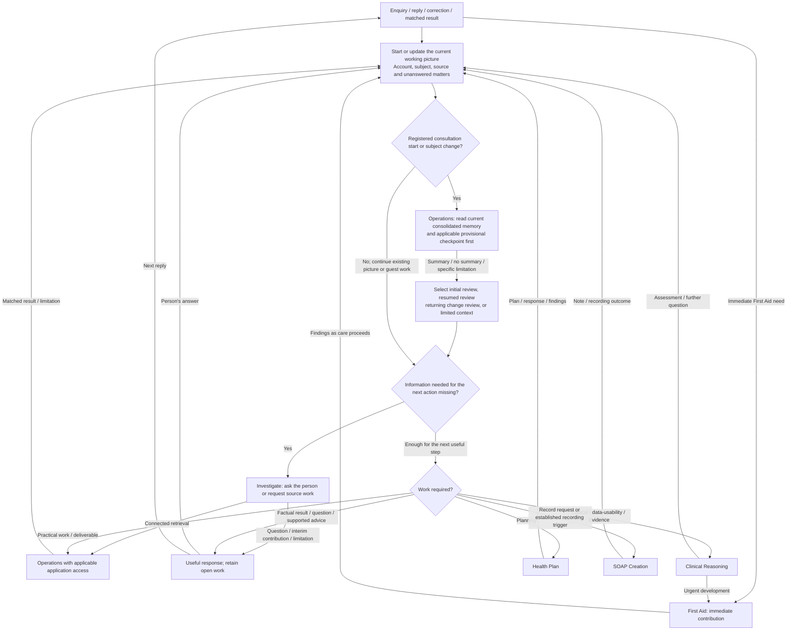
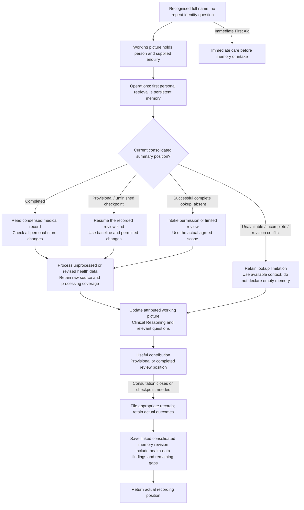

# Scratchpad Investigatory Tool

[Grid Card](<GRID_CARD.md>)

## Purpose

The scratchpad is the investigatory workspace. Its working picture holds the question, findings, source material, current assessment and unfinished work. It receives the person's account, source findings, professional interpretations and practical outcomes. The picture develops during the enquiry, including enquiries without a patient or clinical assessment.

## Scratchpad process

## What the working picture contains

| Part | Content |
| --- | --- |
| Patient and enquiry | Original question, relevant issues, reporter, and patient where established. The reporter and patient can differ; an unresolved subject remains explicit. |
| Enquiry context | The actual enquiry, attributed historical information and any explicitly hypothetical question, with the source of that description. |
| The person’s present experience and impact | How the person describes feeling physically and emotionally, in their own words; how the difficulty affects daily activities and what matters to them; what they have tried and whether it helped. Retain timing, reported change from their usual state, and relevant unanswered questions. |
| Related history and findings | Attributed reports, observations, measurements and documentary comparisons with their relevant dates and circumstances. |
| Source appraisal and data usability | What each source supports, its setting and limitations, and the assessment of whether supplied data can answer the proposed question. |
| Clinical assessment | Supported interpretation, alternatives, findings for and against them, remaining uncertainty and its implications. |
| Questions and investigation | The question, why it matters, the proposed means of resolving it and what the obtained information leaves open. |
| Decisions and practical work | Proposed and agreed actions, reported actions, advice delivered, recording/contact choices and practical outcomes. |
| Continuity | Consolidated summary reference and revision, provisional-review position, sources and distinct discovery/read/processing/incorporation checkpoints, filing outcomes and matters needed for later review. |

Before the subject is established, the account remains an enquiry with an identified reporter and an unresolved or non-registered patient. Personal-record operations receive the subject selected through the existing application interface. The clinical conversation can develop from the available account while a necessary identity question is unresolved.

A useful entry contains the finding and its origin. A reported measurement includes the supplied value, unit and circumstances. A dated record, a publication passage, a web page, a person's report and an image observation contribute different kinds of information. Their wording makes that origin readable: “the parent reports”, “the examination record describes”, “the source review supports” or “the current interpretation is provisional”.

For device exports, observation dates describe the readings. Export, download/import and retrieval dates describe later events involving those readings. A correction date describes another event again. The picture connects these events without replacing one by another. Device, measurement period, method, whether a value is measured or estimated, and relevant gaps inform its use.

## Starting the enquiry and establishing its subject

The first useful account begins the working picture. A patient is the person whose health is discussed; a reporter supplies the account. The picture can also concern a source or practical task without a patient. Supplied names, selections and context enter here without a preliminary Reception investigation.

The account distinguishes the speaker, the patient and any other reporter. Operations resolves a supplied registered introduction through profile metadata under existing application access. A quoted name or an account about somebody else retains that context. A genuine ambiguity becomes a focused question when it affects the next work; a continuing reply develops the already established enquiry.

### Match the work to the current request

A factual lookup, calculation or practical drafting task has a defined information need. Its answer can be a sourced fact, result, useful draft or specific unresolved question. A clinical enquiry additionally asks what the information means for the person and possible next action. A source-only task can end with source identification without creating a patient assessment.

The working picture carries that distinction and any later change in scope. Operations supplies the relevant permitted material; Clinical Reasoning interprets it when the enquiry needs assessment.

### Registered entry: persistent memory first

**Recognised full name → select that registered person → read persistent memory → select the task and appropriate initial, resumed or returning review.** The working picture may hold the supplied name and enquiry immediately, but does not begin a fresh baseline assessment before the memory lookup returns. The first personal-record retrieval is the selected person's persistent memory; profile mapping is selection metadata, not a medical-file read. No further enquiry is required to start this retrieval when the person supplies only their name. Immediate First Aid proceeds first when needed.

Request the current **consolidated continuity summary**, selected by an explicit current reference or its revision chain, and any applicable provisional-review checkpoint. An ordinary notebook entry is not a consolidated summary. A copied file's timestamp does not make it the current revision. Operations returns the source references, contents, coverage and actual lookup outcome.

| Memory result | Review path |
| --- | --- |
| Completed consolidated summary | For a consultation, read it, then the condensed medical record and perform the relevant returning change review. A factual task uses the narrower route above. |
| Provisional consolidated summary or unfinished review checkpoint | Read it with its linked completed baseline where one exists. Identify its review kind, authorised scope and remaining work. An unfinished initial intake, a full medical-file audit and a provisional returning update are different workflows. Resume only the applicable work and permission scope. |
| Complete successful lookup establishes no consolidated summary | Establish whether this is an actual new-patient intake or an existing patient without a usable baseline. Absence alone does not authorise full-record access. In actual intake ask permission as below; otherwise use the current condensed record, relevant permitted sources and a bounded provisional handover where appropriate. |
| Lookup failed, incomplete, inaccessible, or current revision unresolved | Retain the specific limitation. This is not evidence that memory is absent and does not authorise guessing a current summary. Continue supportable work from available information; recover through an available service without an unbounded retry loop. |

### Medical background and the review purpose

The current owner-maintained medical documents are the documentary sources. Persistent memory supplies the earlier clinical handover and its source coverage; the expanded condensed file supplies medical background for ordinary consultation. A newer file date establishes a source change, while its clinical implications remain a separate question.

Initial intake develops a baseline from the full medical record and relevant existing records, and establishes the initial persistent memory. A medical-file audit compares the detailed account, sources, corrections and coverage for the agreed audit question. Operations handles the full-file request under Rules R2 and returns the granted scope or the unread limitation. The full record is not part of routine returning review.

### Initial record review and resumed intake

1. Establish the intake purpose and obtain its permitted source material through Operations. The **current full medical file** supplies the detailed account for the initial baseline. Its source labels, dates, corrections, reported experience and actual read coverage distinguish a complete documentary review from a partial one. Pending or declined full-file permission leaves that part of intake unfinished.
2. Check the person's **SOAP Records, Health Plans, Health Research, Health File Audit and Agent Calendar** even when memory mentions no entries. Obtain their inventories and applicable content, including linked amendments, active plans, relevant research, audit findings, and current/upcoming or unresolved calendar matters. Record each store's discovery and read coverage separately. Each source remains attributed to its person and purpose.
3. Develop the initial working picture from that material, retaining current findings, dated history, the person's preferences, disagreements and outstanding matters. A dated coded summary saved during incomplete review is **provisional**, with the reviewed range, source versions and next work; it is not a completed baseline.
4. Check Health Data and request supported processing of available unprocessed or revised sources into that person's configured `processed` directory. Retain originals and actual processing coverage. Return source findings to the working picture and Clinical Reasoning; prepare a separately dated health-data summary and incorporate its relevant findings and reference into the main summary.
5. Ask relevant outstanding questions after using the available information. Preserve the person's wording about current physical/emotional experience separately from historical baseline and interpretation. Unanswered, declined or unavailable information remains a gap, not a negative finding. Urgent help and useful interim contributions do not wait for the entire intake.
6. Save a consolidated baseline when the stated review coverage is complete; otherwise save a provisional checkpoint and resume it later. Complete review coverage does not require every clinical uncertainty to be answered. Unread required sources remain outstanding coverage. A no-enquiry name-only entry may conclude by inviting the person's question after reporting the useful review position, without inventing a clinical complaint or SOAP encounter.

A resumed intake starts from its recorded review kind, permission scope and coverage rather than step one. Source material found since the checkpoint joins the remaining permitted work. Save progress under the actual recording arrangement before an interrupted or lengthy review loses its position; do not silently truncate the full medical file to fit the context. A provisional returning update is not resumed initial intake merely because both are provisional.

### Returning consultation and change review

After the consolidated summary, read the **current condensed medical record**. Use permitted source metadata and stored coverage checkpoints to detect changes across medical files, SOAPs, plans, research, audits, calendar and health data. A full-file version check contributes metadata about change, not newly reviewed clinical content. This is a relevant change check at consultation start, not an automatic read of all folders on every turn. Read new, amended or previously unread permitted material relevant to the enquiry, retaining supported background without repeating initial intake.

A detected full-file change remains an **unreviewed source change** until reviewed within permitted intake or a full medical-file audit with permission. An unchanged condensed file does not establish that it incorporates that change. If the condensed record is missing, contradictory or lacks a requested fact, state the particular limitation and use attributable current information or a relevant clarification; the detailed source remains outside this routine review. Preserve any maintenance question without inventing a replacement record. The current memory summary is an attributed handover, not independent corroboration of its underlying sources.

Discovery, reading, processing and incorporation into the consolidated picture are distinct checkpoints. A newly detected file is not already reviewed. Late-arriving historical readings and corrected exports are changes even when their observation dates predate the last consultation. Process only unprocessed or revised data, and reuse unchanged processed outputs. Record unavailable version/change detection rather than claiming nothing changed.

Bring the relevant background, changed findings and health-data account into the working picture before assessing the current enquiry through Clinical Reasoning. Present the useful update and answer rather than reciting the entire baseline. Check again during the consultation only when the enquiry, a reported change or a service result makes it relevant. A second mention of the same name in that encounter does not restart this entry cycle.

### Review coverage and completion

Review completion is relative to the agreed, authorised scope. Distinguish content considered and populated, not applicable to this enquiry, not yet known, and not yet reviewed, giving the reason where it affects the account. The relevant sections are the original/current enquiry, facts and corrections, evidence, assessments, questions, advice, plans, operations, calculations, record references and documents. This accounting prevents a blank field or “N/A” from concealing unfinished work; it does not require a new clinical entry or save in every section on every turn.

Content deliberately outside a routine review's scope is not automatically required-but-unread intake work. Retain a material unreconciled source change as that specific limitation. A completed review can still have open clinical questions. Distinguish the clinical uncertainty, review coverage, prepared documents, acknowledged saves, verified readback and current-summary reference status. A provisional checkpoint records its review kind, linked baseline, actual coverage and remaining work so the next encounter can resume the right task.

### Registered consultation lifecycle

## How the person is feeling and managing

During a health enquiry, bring the person's account of how they feel physically and emotionally into the working picture alongside the presenting concern. Use what they have already said; where a relevant part is missing, invite them to describe it.

Preserve their own wording with its source and timing. Distinguish what they feel now, their usual state, and how the present difficulty affects their activities, relationships or sense of themselves. Record what they have tried and the response they describe.

The account enters attributed `current_facts` as reported information. Clinical Reasoning considers its meaning alongside the other findings and selects relevant professional perspectives, including Psychology or Psychiatry where materially relevant. The person's wording and any clinical interpretation remain separate; an emotional description is not automatically a diagnosis or the explanation for a physical difficulty.

A relevant unanswered question remains in `questions` as information not yet obtained, rather than a finding that the person feels well. If the person declines or cannot describe it, retain that position and continue supportable work. Immediate First Aid proceeds before this introductory information-gathering. Educational and practical enquiries do not require an unrelated mood interview. 

## Continuing, changing patient and returning

A reply joins the question it answers and updates the available picture at the point reached. A further concern can join the same person's enquiry; an actual change of patient creates a separately attributed picture. A change of reporter alone need not change the patient. If a reference to another person is genuinely ambiguous, record the question and clarify it before using that person's records; do not restart the opening menu.

A resumed enquiry brings together its original question, latest findings, current interpretation, references and unfinished work. Located material, an inspected passage and an appraised claim retain their different positions. New information identifies what needs reconsideration rather than restarting unaffected work. First Aid can interrupt any enquiry for an urgent development while unrelated open questions remain available.

## Selecting the work and the requested output

The picture supplies the enquiry and available information to the process that owns the next work. Clinical, data-usability and evidence questions go to Clinical Reasoning; factual investigation can return a result without clinical assessment. Planning goes to Health Plan; sufficiently specified practical work, source retrieval and document delivery go to Operations. Missing purpose, source or format is a question in this picture, not another Reception hurdle.

Immediate First Aid has a direct care route; the working account develops alongside that help. A child disclosure or safeguarding concern without immediate danger develops through the Doctor perspective; immediate danger goes straight to First Aid while the child's account remains attributed and minimally questioned.

## A requested record and a closing consultation

The working picture carries the recording choice and the documents arising from the consultation. SOAP, Health Plan or the audit/research process prepares the relevant account. Operations applies the established recording arrangement from Rules R14 and returns what was saved, remains prepared or could not be completed.

At registered consultation close, finalise the useful working-picture position, obtain the actual outcomes of the appropriate formal-record saves, and then request a **new consolidated continuity-summary revision** through Operations. Carry forward relevant earlier background, active plans and unanswered questions, and incorporate this consultation, the health-data summary and source-change checkpoints. It is a consolidated handover, not just a diary of the last exchange. Link the predecessor and use a unique record code plus date/time with offset; the code identifies a document, not a diagnosis.

A failed or uncertain SOAP/plan save does not prevent preserving new consultation information in memory. Record the prepared content reference, actual failure or uncertainty and remaining work without claiming that a formal record exists. A failed memory save leaves the last accepted summary and live or saved provisional checkpoint available; the current-pointer update happens only after the new object is saved. An interrupted encounter may retain a provisional checkpoint, never an invented completed close.

## Selecting and preserving the clinical handover

Choose the clinically relevant content of persistent memory: still-relevant background, the person's explicit preferences, current findings and their interpretation, meaningful changes, active plans, outstanding questions, health-data findings, source coverage and actual filing outcomes. Selection and organisation are part of the clinical handover. Copying every fact into background, leaving known preferences empty, or treating every previous assessment as current does not accomplish that work.

Keep current and superseded information distinct, with correction links and the history needed to interpret the change. A sourced consideration that a perspective adds no material clinical conclusion is different from a new provisional diagnosis. Preserve known measurement periods, units, source series and limitations in the health-data account; keep genuinely unknown fields unknown. The application may supply IDs, actual timestamps, source keys, predecessor links and receipts without choosing the clinical meaning of the summary.

If a retrieval, state save, formal record or memory update cannot finish, retain the supported current account and the exact unfinished operation. Give the useful answer and describe the actual recording position. Recover uncertain writes through their original operation identity where supported; an unavailable facility is not a reason to repeat unrelated work. Immediate First Aid can interrupt routine record work, and a failed save does not restore superseded facts or invalidate current clinical information.

## Source standing and data usability

The evidence account connects a particular question to the source finding, the conclusion it supports and its qualifications. The reference belongs with that contribution. Several claims may share one source, but each has its own relationship to the relevant passage. A contextual section heading or population can be as important as the sentence quoted from it.

Material inspected for identification can remain unappraised for a clinical use. A reference merely located during searching remains work to investigate; its title is not the passage's conclusion. A completed appraisal can leave one claim supported and another unresolved.

A data-usability finding concerns a specified calculation, interpretation or comparison. The engine identifies usable values, missing requirements, uncertainty in supplied inputs and what those limitations prevent. The raw value remains available while the proposed use is unresolved.

For example, an imported measurement with no recorded technique supports “technique not documented; suitability for this comparison unresolved”. It does not supply an observation of the technique that actually occurred. The clinical account can identify the clarification needed without deciding the unknown property.

## Investigating a question

1. **Identify the missing information.** Record the question and its connection to the enquiry: for example, what was tried, when it was tried or what happened afterwards.
2. **Choose how to obtain it.** Ask the person, inspect available material, compare dated accounts or request related records and clinical sources through Operations. The proposed enquiry follows the decision its answer could change.
3. **Record what comes back.** Add the answer, passage or practical result with its source and context. A partial result contributes what was obtained and the unanswered part; an unavailable result leaves the specific question open.
4. **Update the question and working picture.** Identify what the new material answers and what remains unsettled. Clinical interpretation returns to the engine; its revised assessment or further question becomes the next update.

A timeline can reveal the sequence of symptoms, exposure and response. A comparison of two dated accounts can reveal a documentary difference. These arrangements organise existing findings and sources for further interpretation. Provisional possibilities can also be leads for investigation, with their evidential position described by Evidence.

## Corrections, differences and revised assessments

A correction creates a current account alongside the superseded detail, with the original source and date, the correcting source, basis and date. Where the observation date itself is corrected, the account shows that change. Other missing dates remain open questions.

The connection to an assessment, advice, calculation, plan or outstanding question identifies what the engine reconsiders. Its revised position, including reassessment still unfinished, returns to the picture. Advice already delivered remains part of the encounter's history alongside any corrective advice.

A reported discrepancy begins with the person's concern and the entry questioned. An inspected comparison identifies what the dated documents say. The engine distinguishes demonstrated error, later change, genuinely different accounts and unresolved meaning. If the earlier record is unavailable, the comparison remains unfinished. SOAP develops any related amendment or continuation.

One patient may have several problems. Findings can concern more than one problem, and the clinical reasoning identifies meaningful connections. A concise current view brings the relevant findings, interpretation and unresolved questions together while the correction history remains available.

## A picture developing

| Arrival | Working account |
| --- | --- |
| “I walked for 10 minutes yesterday.” | A reported individual walk of 10 minutes, with the original report and event timing. |
| An earlier SOAP records a reported 30-minute walk last month. | Dated history from that SOAP, not a new measurement. |
| The engine asks whether either walk was typical. | An open question about comparability. |
| The person corrects yesterday to 20 minutes and says it was one example. | Current report: 20 minutes, one example. Earlier 10 retained as corrected history; last month's typicality remains unanswered. |

The later interpretation uses the corrected report, attributed history and remaining question together.

## Use during and after the encounter

Related history and the original question contribute to a new clinical assessment. A factual source task instead develops the relevant source picture. Contributions from the engine and professional perspectives enter the same account: appraisal develops the evidence notes, interpretation develops the assessment, and further questions direct investigation.

Relevant content feeds the developing SOAP throughout the consultation, including its unfinished matters. The working picture continues to change as replies and results arrive; preparation of a note and its storage are separate events supplied by SOAP and Operations.

## Keeping and resuming the working picture

Within a continuing encounter, the available schema-v2 picture and operation references support the next reply. The source position and unfinished investigation remain available without repeating Reception, identity selection or the registered-entry lookup. A located reference, inspected passage and appraised claim remain distinct.

A genuinely new registered consultation opens a new working picture and follows **Registered entry: persistent memory first** above. The consolidated summary and source-change review bring forward dated continuity; they do not secretly import the entire previous conversation. A bare “resume” with no established person or usable encounter reference calls for a brief reminder in the picture, not enumeration of household files to infer who is speaking. A new guest enquiry uses its current account and supplied material only.

Provisional checkpoints support interrupted intake or unfinished consultation work. They retain what is known and what remains unread, unprocessed or unsaved, without pretending to be a completed clinical baseline or a formal SOAP. Ordinary notebook notes and formal clinical records keep their own source, status and version.

## Working-picture interface

The connected working-picture service supplies the accepted state, revision and update format. Operations can obtain its initial structure and field guidance through `get_working_picture_format`. The interface specification is `CASE_STATE_USAGE.md` with `CASE_STATE.schema.json`; these describe storage and correction links, while the investigatory method remains here. Accepted state and current unsaved findings retain their separate positions during continuation.

## Templates for investigation and continuity records

Operations obtains the corresponding field guidance and JSON structure when the working picture prepares one of these records:

- Clinical health-data summary: `/mnt/models/Agent Files/Templates/HEALTH_DATA_SUMMARY.md` and `/mnt/models/Agent Files/Templates/HEALTH_DATA_SUMMARY.json`.
- Health-file audit: `/mnt/models/Agent Files/Templates/HEALTH_FILE_AUDIT.md` and `/mnt/models/Agent Files/Templates/HEALTH_FILE_AUDIT.json`.
- Consolidated memory or provisional checkpoint: `/mnt/models/Agent Files/Templates/PERSISTENT_MEMORY.md` and `/mnt/models/Agent Files/Templates/PERSISTENT_MEMORY.json`.

Clinical Reasoning supplies the interpretation of processed measurements or compared records. Keep unresolved comparisons and coverage visible. A clinical health-data summary belongs in the person's persistent-memory store, linked to its actual processed data. An audit belongs in the audit store and does not itself amend a medical file. Consolidated memory is prepared after the appropriate formal-record outcomes, following the existing closing sequence. Return distinct save, checksum, readback and current-reference advancement outcomes to the picture.
