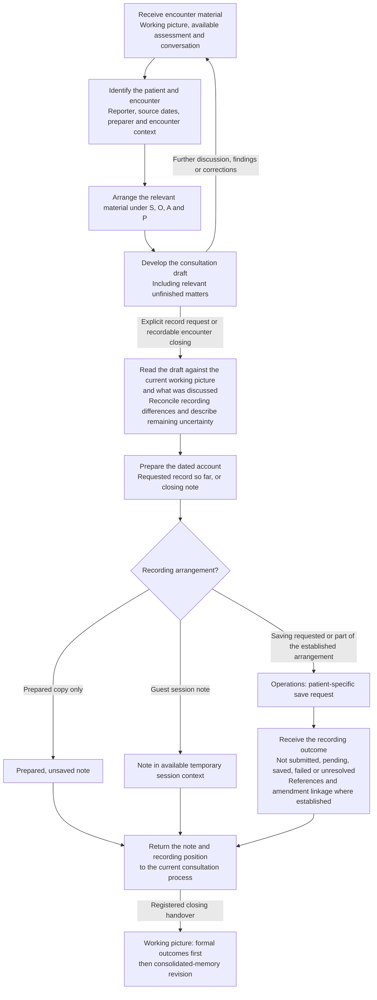
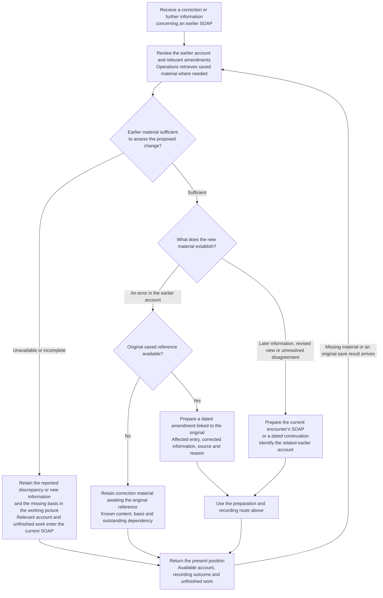

# SOAP Creation Tool

[Grid Card](<GRID_CARD.md>)

## Purpose

SOAP develops a dated consultation account from the working picture, assessment and discussion under Subjective, Objective, Assessment and Plan. The draft develops during the encounter. A requested record describes the position so far; a closing account describes the exchange reached at that time. Recording or saving has a separate outcome.

The working picture supplies the recording arrangement and purpose of the account. Its clinical content can be prepared before any storage result is available.

## Working procedure

1. **Identify the encounter.** Bring together the person's existing reference where available, current enquiry, reporter, source dates and recording arrangement.
2. **Build S, O, A and P.** Use the current picture, assessment and conversation to describe reports, documented findings, interpretation and the advice or plan discussed.
3. **Update during the exchange.** Incorporate corrections, new findings, decisions and unfinished matters as the consultation develops.
4. **Review the account.** Compare the draft with the current picture and conversation, preserving both factual values and the meaning of uncertainty.
5. **Prepare and file.** At an explicit note request or a recordable encounter close under the supplied recording arrangement, prepare the dated account. Operations handles any save under that arrangement and returns the actual outcome and reference.
6. **Return the handover material.** Return the prepared account and actual filing outcome to the working picture. At registered consultation close it supplies these, alongside plan and other document outcomes, to the subsequent consolidated-memory revision. Relevant SOAPs remain dated source records for later review; memory is not a substitute for their saved references.

## Create, finalise and record

## Correct or extend an earlier account

## Building the note

The scratchpad supplies the findings, source appraisal, corrections and open questions. Clinical Reasoning supplies the current assessment; the conversation supplies advice actually discussed and the person's responses. Factual recording or practical preparation may involve no clinical assessment.

The note identifies the patient, existing patient reference where available, encounter, reporter where different, preparer and preparation date. Source documents and earlier events retain their own dates. Relevant preferences, decisions, review and unfinished work describe the position reached. [GMC: recording clinical work](https://www.gmc-uk.org/professional-standards/the-professional-standards/good-medical-practice/domain-3-colleagues-culture-and-safety).

Record provenance identifies the preparer, any human review and the source encounter. This travels with the account during later retrieval, alongside the attributed reporter and clinical sources. Operations and the record template supply its exact fields; Rules R14 owns the authorship and filing requirements.

### Document identity and recording position

| Detail | Meaning |
| --- | --- |
| Encounter context | The actual enquiry, attributed historical account or explicitly hypothetical question represented. |
| Document kind | Consultation note, dated continuation, linked amendment or correction material awaiting a reference. |
| Preparation | Developing draft or prepared dated account. |
| Recording | Unsaved/preparation-only, or the position returned by Operations. |
| Relationships | Relevant earlier record and any established amendment or saved-note reference. |

A requested account can be prepared and unsaved. A dated amendment may await storage. These are different aspects of the document, not interchangeable labels.

### Mapping the material to SOAP

| Section | Encounter material |
| --- | --- |
| S — Subjective | Presenting question, symptoms, experience, concerns and history reported by the person or another reporter. A reported record discrepancy belongs with its reporter. |
| O — Objective | Available measurements, tests and documented examination findings with sources, dates and method limitations. An inspected documentary comparison is described as a finding about those documents. |
| A — Assessment | Current interpretation, reasons, alternatives, uncertainty and relevant historical connections. A record-review conclusion explains the standing and implications of disputed information. |
| P — Plan | Advice delivered, proposed and agreed actions, ownership, support, timing, review, decisions about actions not taken and unfinished investigation. |

These headings follow the [SOAP documentation structure](https://www.ncbi.nlm.nih.gov/books/NBK482263/). The nature of the material determines its position: an earlier symptom is attributed history; an earlier assessment remains that dated interpretation. A source-page illustration is reference material rather than an examination finding about the patient.

Relevant references beside statements make their basis retrievable. The note's wording carries the distinction between a person's report, a documented finding, a source conclusion and the current interpretation. Multiple problems can have their own named account within each section.

## Recording a review of the record

A reported discrepancy begins in S with the questioned entry. O describes the inspected dated sources and differences. A records the reasoning conclusion: demonstrated error, later change, differing accounts or unresolved meaning. P sets out correction, verification or review. A separate detailed audit can accompany the note through its reference without turning the audit into a new SOAP section.

The distinction between data history and clinical interpretation remains useful throughout. For example, a measured event, later download and subsequent correction can have three dates. The audit's chronology and the note's relevant source description explain those events separately.

## Developing and finalising the account

A draft contains the relevant concern, findings, interpretation, advice, choices and unresolved matters. The current picture supplies revisions while discussion continues. At finalisation, review compares the draft with that picture and the conversation, including corrected details and the sequence of advice where it changed.

This comparison concerns meaning as well as copied values. For a measurement whose technique is not documented, the account can say that standardisation is unestablished and suitability for a diagnostic comparison remains unresolved. That is different from an observation that the technique was non-standard. The next step is the clarification or measurement identified by assessment.

For a corrected walking report, the note can show the current duration and its correction history while an unanswered question about typicality remains open. For a proposed action, the person's response may still be unknown. Finalisation records those positions rather than completing the clinical work by wording alone.

## Plans and unfinished matters

Health Plan contributes goals, actions, owners, support, timing and review. These can have different statuses together: an agreed action may be to discuss an option with a GP, whose later decision remains open. A programme not attempted, an unsuccessful trial and an action awaiting agreement are different histories.

Relevant choices about recording, booking or contact and the assistance actually provided form part of the account. An unavailable facility is a different event from a person's decision against using it. These details help later readers understand the work left to do.

Within P, unfinished matters name the issue, outstanding question or result, why it matters and the next step discussed. A reference can connect the matter to an acknowledged pending operation or earlier source. The assessment states the effect of uncertainty; the plan states its outstanding investigation.

## Saving and continuation

The recording arrangement can be a prepared copy, temporary session note or a record submitted through Operations. The returned position describes the note and any established stored reference or linkage. A storage limitation accompanies prepared content while the enquiry continues.

A note of the consultation so far does not end the discussion. Further information after an earlier recorded account can form a dated continuation, linked to its encounter. A later registered consultation reads its current consolidated memory first, then the condensed record and changed or relevant original notes/amendments as attributed history.

## Corrections and later information

A correction identifies the affected entry, corrected information, source, reason and date. The original remains the historical account to which the amendment relates. The correcting source's date, the affected event date and the amendment's preparation date describe separate events. Further corrections can relate to the amendment they change. [NHS England: amending records](https://digital.nhs.uk/data-and-information/information-governance/guidance/amending-patient-and-service-user-records).

A medicine changed after a consultation is later information; an earlier note naming the wrong medicine is an error in that account. Clinical Reasoning supplies any reassessment of the earlier interpretation. SOAP describes that revised view and its basis while retaining the dated history.

### Unavailable earlier material

If the earlier note or relevant amendment is unread or incomplete, the current account describes the person's concern or new information and the comparison still needed. Known correction content can remain preparatory while its original saved reference is missing. Once the missing material arrives, review determines whether an amendment, continuation or unresolved comparison is appropriate.

## Later use

Patient and encounter details, problem names, dates and references support finding relevant history. Operations retrieves the material requested; the scratchpad receives its attributed account and applicable amendments. Clinical Reasoning considers its meaning alongside current information. The note carries continuity without turning an old conclusion into an automatically current one.

## Record identity and closing

The template and record interface carry patient, encounter, note identity, event and preparation dates, provenance and amendment links. Operations supplies the actual saved reference and content revision. At close, the existing accepted account is compared with the current discussion: unchanged content reuses its saved reference, while later information or a correction takes the appropriate continuation or amendment route. Formal-record outcomes then feed the consolidated handover.

## Record template

Operations reads `/mnt/models/Agent Files/Templates/SOAP.md` and `/mnt/models/Agent Files/Templates/SOAP.json` for an appropriate SOAP, continuation or amendment. Use the Markdown field guidance and JSON structure with the encounter content and metadata specified above. A template is a blank specification; its unknowns and draft status are not a saved clinical record. The prepared record goes to the established subject's SOAP store. Return the actual save, checksum and readback results separately.
